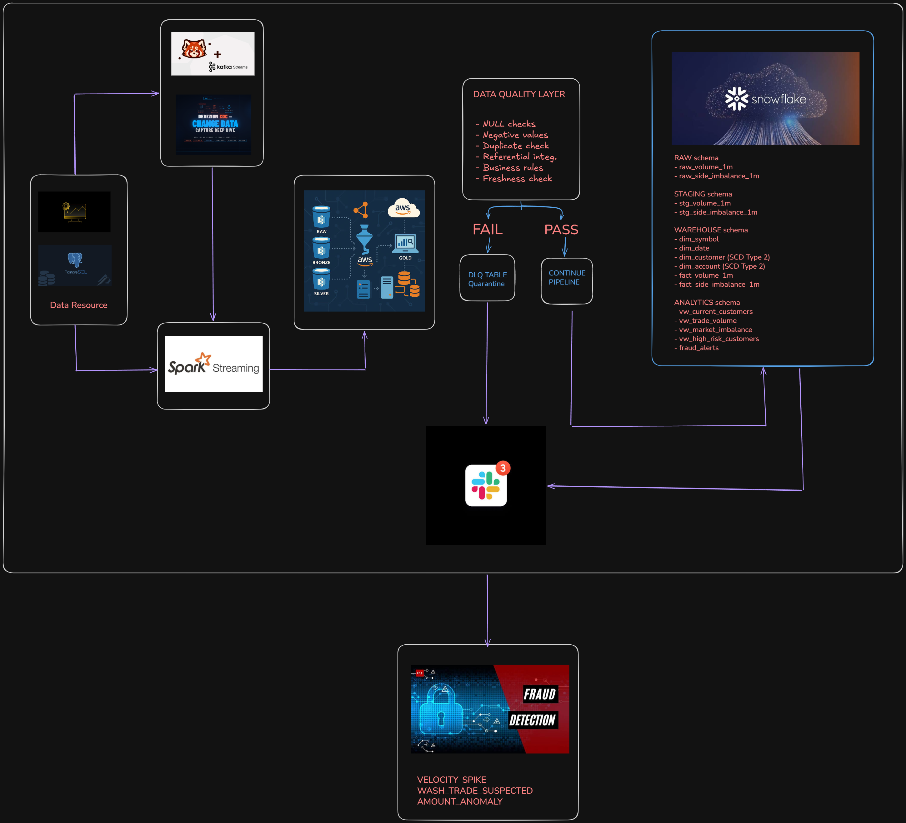

# Real-Time Financial Data Engineering & Fraud Detection Platform

A **production-grade, end-to-end streaming data platform** that ingests live cryptocurrency market data from Binance.US at ~66 messages/second, processes it through a medallion architecture on AWS S3, loads it into a Snowflake data warehouse, and runs automated fraud detection with real-time Slack alerting.

Built to enterprise standards: idempotent Kafka producers, SCD Type 2 CDC via Debezium, schema-enforced Pydantic models, structured JSON logging with correlation IDs, a six-check Data Quality framework, pipeline observability via metadata logging, and a fully automated CI/CD pipeline (ruff + mypy) that passes in 27 seconds.

---

## System Architecture



The platform is organized into five independent layers that each own a single responsibility:

**Ingestion** — An async Python WebSocket client streams `aggTrade` and `bookTicker` events for 5 symbols from Binance.US. Each message is wrapped in a typed envelope (schema version, event ID, correlation ID) and published to Redpanda (Kafka-compatible) with idempotency, `acks=all`, and lz4 compression. PostgreSQL operations are captured via Debezium CDC and published on the same broker.

**Stream Processing** — Apache Spark Structured Streaming consumes from Kafka and materializes three layers of Parquet on AWS S3: Bronze (raw, 30s micro-batches), Silver (typed + deduplicated, 60s), and Gold (1-minute window aggregates: `volume_1m` and `side_imbalance_1m`).

**Data Warehouse** — AWS Glue catalogs the S3 data. A six-stage Snowflake pipeline (RAW → STAGING → WAREHOUSE → ANALYTICS) loads and transforms the Gold data. Dimensions use SCD Type 2 with `effective_from` / `effective_to` timestamps, populated by CDC events from Debezium via a `MERGE` stored procedure.

**Fraud Detection** — Three SQL rules run against `ANALYTICS.fraud_alerts`: `VELOCITY_SPIKE` (volume > 3× 7-day average), `WASH_TRADE_SUSPECTED` (buyer = seller ratio within 5 min), and `AMOUNT_ANOMALY` (notional > 4× rolling σ). A Python notifier reads uninvestigated alerts, posts Block Kit messages to Slack, and marks them investigated.

**Observability** — Every pipeline run writes a row to `pipeline_runs` in Snowflake: records in/out/failed, duration, stage, status, and a VARIANT metadata column for arbitrary context.

---

## Tech Stack

| Layer | Technology |
|---|---|
| Ingestion | Python 3.11 + asyncio · `confluent-kafka` · Binance.US WebSocket |
| Message Broker | Redpanda v24.2.7 (Kafka-compatible, Docker) |
| CDC | PostgreSQL 16 + Debezium 2.7.3 |
| Stream Processing | Apache Spark 3.5.3 Structured Streaming |
| Data Lake | AWS S3 — Bronze / Silver / Gold medallion architecture |
| Data Catalog | AWS Glue |
| Data Warehouse | Snowflake (XSMALL warehouse, auto-suspend 60 s) |
| Alerting | Slack Incoming Webhooks · Block Kit |
| CI/CD | GitHub Actions — ruff lint + mypy type-check |
| Runtime | Python 3.11 + uv · Docker Compose (local infra) |

---

## Repository Structure

```
├── config/
│   └── settings.py              # Pydantic settings, env vars, lru_cache
├── src/
│   ├── common/
│   │   ├── logging_config.py    # JSON structured logging, correlation_id
│   │   └── metadata.py          # Pipeline run logging → Snowflake
│   ├── ingestion/
│   │   ├── api/binance_ws.py    # Async WebSocket client, exponential backoff
│   │   ├── models/              # Pydantic models: AggTrade, BookTicker, Envelope
│   │   ├── producer.py          # Kafka producer (idempotent, acks=all, lz4)
│   │   ├── writer.py            # JSONL writer, Hive-partitioned rotation
│   │   └── run_ingestion.py     # Entry point, routes to topics + DLQ
│   ├── spark/
│   │   ├── session.py           # SparkSession factory, Kafka + S3A JARs
│   │   ├── bronze.py            # Kafka → S3 raw Parquet (30s trigger)
│   │   ├── silver.py            # Bronze → typed Parquet, dedup (60s trigger)
│   │   └── gold.py              # Silver → 1-min window aggregates (60s trigger)
│   ├── alerts/
│   │   ├── slack.py             # SlackAlerter, Block Kit fraud + DQ alerts
│   │   └── fraud_notifier.py    # Reads uninvestigated alerts, notifies, marks done
│   └── dq/
│       ├── checks.py            # DQFramework, DQResult, run_check()
│       ├── snowflake_checks.py  # 6 DQ checks against Snowflake
│       └── run_dq.py            # DQ entry point
├── sql/snowflake/
│   ├── 001_setup.sql            # Warehouse, database, schemas, S3 integration
│   ├── 002_raw.sql              # COPY INTO raw tables
│   ├── 003_staging.sql          # Cleaned staging tables, QUALIFY dedup
│   ├── 004_dimensions.sql       # dim_symbol, dim_date, SCD2 customer/account
│   ├── 005_facts.sql            # fact_volume_1m, fact_side_imbalance_1m
│   ├── 006_scd_merge.sql        # merge_dim_customer() stored procedure
│   ├── 007_analytics.sql        # 4 analytical views
│   ├── 008_fraud_detection.sql  # fraud_alerts table + 3 detection rules
│   └── 009_metadata.sql         # pipeline_runs observability table
├── docker-compose.yml           # Redpanda, Console, PostgreSQL, Debezium
├── pyproject.toml               # uv deps + ruff + mypy config
└── .github/workflows/ci.yml     # lint + type-check on push
```

---

## Pipeline in Production

### 1. CI/CD — GitHub Actions


Every push to `main` triggers two parallel jobs: **lint** (ruff check + ruff format) and **type-check** (mypy over the full `src/` tree). Both gates must pass before merge. The entire pipeline completes in **27 seconds**. Node.js deprecation notices are cosmetic and do not affect the build.

---

### 2. Message Broker — Redpanda


The `binance.quotes.v1` topic receives live `bookTicker` events from Binance.US. Each message is a JSON envelope containing `event_type`, `event_id`, `schema_version`, `source`, `occurred_at`, `ingested_at`, and a `payload` with best bid/ask price and quantity. Messages are compressed with **lz4**, partitioned by symbol, and retained for ~7 days. The topic here shows **3,493 estimated messages** with live refresh.

---

### 3. Cloud Infrastructure — AWS IAM


A dedicated IAM user `raghav-fraud-platform` is provisioned with least-privilege policies scoped only to the platform's S3 bucket. No console access — programmatic access only via AWS CLI / Spark's S3A connector. Credentials are injected at runtime via environment variables, never hardcoded.

---

### 4. Bronze Layer — Raw Parquet on S3


Spark Structured Streaming writes raw Kafka payloads to S3 as Snappy-compressed Parquet files under `bronze/date=YYYY-MM-DD/hour=HH/topic=<topic>/`. The 30-second micro-batch trigger produces multiple part files per hour partition. This layer is **append-only** and serves as the immutable source of truth — no transformations, no filtering. Shown here: **26 part files** for `topic=binance.trades.v1` on 2026-09-21, hour 17.

---

### 5. Silver Layer — Typed & Deduplicated


The Silver job reads Bronze Parquet, applies the Pydantic-derived schema (casts strings to decimals, timestamps to proper types), and deduplicates on `event_id` using Spark's `dropDuplicates`. Output is partitioned into `silver/trades/` and `silver/quotes/` with date/hour sub-partitions. A Spark checkpoint directory (`_checkpoints/`) maintains exactly-once semantics across restarts.

---

### 6. Gold Layer — 1-Minute Window Aggregates


The Gold job applies a **1-minute tumbling window** over Silver trades and quotes, computing per-symbol aggregates: total volume, trade count, VWAP, buyer/seller notional, and side imbalance ratio. Shown here: `gold/side_imbalance_1m/date=2026-09-21/hour=17/` with **4 Snappy Parquet files** (~1.7 KB each), representing 4 micro-batch intervals. These files are the input for the Snowflake COPY INTO pipeline.

---

### 7. Snowflake Data Warehouse — Schema & Objects


The `FRAUD_PLATFORM` database contains four schemas. The **TRANSFORMED** (warehouse) schema holds the full star schema: `DIM_ACCOUNT`, `DIM_CUSTOMER`, `DIM_DATE`, `DIM_SYMBOL`, `FACT_SIDE_IMBALANCE_1M`, `FACT_VOLUME_1M`, `FRAUD_ALERTS`, and the `MERGE_DIM_CUSTOMER()` stored procedure. All objects are owned by `ACCOUNTADMIN` and run on the `FRAUD_WH` (X-Small) virtual warehouse with 60-second auto-suspend.

**Snowflake schema layout:**

RAW schema
- raw_volume_1m
- raw_side_imbalance_1m

STAGING schema
- stg_volume_1m
- stg_side_imbalance_1m

WAREHOUSE schema (TRANSFORMED)
- dim_symbol
- dim_date
- dim_customer (SCD Type 2)
- dim_account (SCD Type 2)
- fact_volume_1m
- fact_side_imbalance_1m

ANALYTICS schema
- vw_current_customers
- vw_trade_volume
- vw_market_imbalance
- vw_high_risk_customers
- fraud_alerts

---

### 8. SCD Type 2 — Customer Dimension History


`dim_customer` implements **Slowly Changing Dimension Type 2**: each CDC event from PostgreSQL via Debezium produces a new row with `effective_from`, `effective_to`, `is_current`, and `cdc_operation` columns. Shown here: customer `Mei Tanaka` (ID 3) has **3 history rows** — initial read snapshot (`r`), then two updates (`u`) where `risk_tier` was promoted from `low` to `high`. The current active row has `is_current = TRUE` and `effective_to = null`. History is preserved indefinitely.

---

### 9. Fraud Detection — Alerts in Snowflake


Three fraud detection rules fire SQL against the `ANALYTICS` schema every run cycle. Results are written to `ANALYTICS.fraud_alerts`. Shown here: **3 live alerts** — two `WASH_TRADE_SUSPECTED` (CRITICAL) for `SOLUSDT` where buyer/seller trade counts are perfectly symmetric (`imbalance_ratio: 0.0`), and one `VELOCITY_SPIKE` (HIGH) for `XRPUSDT` where trade count hit **33** against a 7-day average of **9** (spike ratio: 3.67×). The `details` VARIANT column stores rule-specific JSON evidence.

---

### 10. Pipeline Observability — Metadata Logging


Every pipeline run writes a row to `pipeline_runs` in Snowflake via `src/common/metadata.py`. Columns: `run_id` (auto-increment), `pipeline_name`, `stage`, `status`, `records_in`, `records_out`, `records_failed`, `started_at`, `finished_at`, `duration_sec`, `error_message`, and a `VARIANT metadata` column. Shown here: `binance-ingestion` Bronze run — **1,000 records in, 1,000 records out, 0 failed**, status `SUCCESS`, 60 seconds duration.

---

### 11. Slack Alerting — Fraud Notifier


`src/alerts/fraud_notifier.py` queries `ANALYTICS.fraud_alerts WHERE is_investigated = FALSE`, fires a Block Kit POST for each alert via `SlackAlerter`, and then flips `is_investigated = TRUE` to prevent duplicate notifications. The terminal shows a direct test: `sent: True` confirms the webhook delivery. This runs on-demand or can be scheduled as a cron job.

---

### 12. Slack — Live Fraud Alerts Channel


The `#fraud-platform` Slack channel receives formatted Block Kit alerts with: alert type (colour-coded 🔴 CRITICAL / 🟡 HIGH), symbol, severity, window timestamp, alert value, threshold, rule name, and a JSON `details` block with rule-specific evidence. Shown here: `VELOCITY_SPIKE` on `XRPUSDT` (spike ratio 3.67×) and two `WASH_TRADE_SUSPECTED` alerts on `SOLUSDT` with full buyer/seller notional and imbalance ratio breakdown.

---

## Fraud Detection Rules

| Rule | Severity | Trigger |
|---|---|---|
| `VELOCITY_SPIKE` | HIGH | Symbol volume > 3× its 7-day average in a 1-min window |
| `WASH_TRADE_SUSPECTED` | CRITICAL | Buyer = seller pattern within a 5-min window |
| `AMOUNT_ANOMALY` | HIGH | Single trade notional > 4× rolling standard deviation |

---

## Data Quality Checks

Six automated checks run against Snowflake via `src/dq/run_dq.py`:

| Check | Table | What it verifies |
|---|---|---|
| `NULL_CHECK` | `fact_volume_1m` | No nulls in key columns |
| `NEGATIVE_VALUES` | `fact_volume_1m` | No negative notional / trade counts |
| `DUPLICATE_CHECK` | `fact_volume_1m` | No duplicate (symbol, window_start) pairs |
| `REFERENTIAL_INTEGRITY` | facts → dims | Every fact row joins to a valid `dim_symbol` |
| `BUSINESS_RULE_VWAP` | `stg_volume_1m` | VWAP within ±50% of avg_price |
| `FRESHNESS_CHECK` | `fact_volume_1m` | Data loaded within past 24 hours |

---

## Running Locally

**Prerequisites:** Docker Desktop · Python 3.11 · uv · Java 17 (WSL2 for Spark on Windows) · AWS CLI

```bash
# 1. Clone and install
git clone https://github.com/ragztigadi/Real-Time-Financial-Data-Engineering-Fraud-Platform
cd Real-Time-Financial-Data-Engineering-Fraud-Platform
uv sync

# 2. Copy and fill env vars
cp .env.example .env

# 3. Start local infra (Redpanda, PostgreSQL, Debezium)
docker compose up -d

# 4. Run ingestion → streams to Redpanda
uv run python -m src.ingestion.run_ingestion

# 5. Spark Bronze (WSL/Linux)
uv run python -m src.spark.bronze

# 6. Spark Silver
uv run python -m src.spark.silver

# 7. Spark Gold
uv run python -m src.spark.gold

# 8. Run DQ checks
uv run python -m src.dq.run_dq

# 9. Send fraud alerts to Slack
uv run python -m src.alerts.fraud_notifier
```

---

## Environment Variables

| Variable | Description |
|---|---|
| `BINANCE_WS_URL` | `wss://stream.binance.us:9443/stream` |
| `BINANCE_SYMBOLS` | `btcusdt,ethusdt,solusdt,bnbusdt,xrpusdt` |
| `KAFKA_BOOTSTRAP_SERVERS` | `localhost:19092` |
| `AWS_REGION` | `us-east-1` |
| `S3_BUCKET` | S3 bucket name |
| `BRONZE_PATH` / `SILVER_PATH` / `GOLD_PATH` | `s3a://...` paths per layer |
| `SNOWFLAKE_ACCOUNT` | Snowflake account identifier |
| `SNOWFLAKE_USER` | Snowflake username |
| `SNOWFLAKE_WAREHOUSE` | `FRAUD_WH` |
| `SNOWFLAKE_DATABASE` | `FRAUD_PLATFORM` |
| `SLACK_WEBHOOK_URL` | Incoming webhook URL |

---

## CI/CD

GitHub Actions runs on every push to `main`:

- **lint** — `ruff check` + `ruff format --check` (23s)
- **type-check** — `mypy src/` (19s)

Total pipeline: **27s** ✅